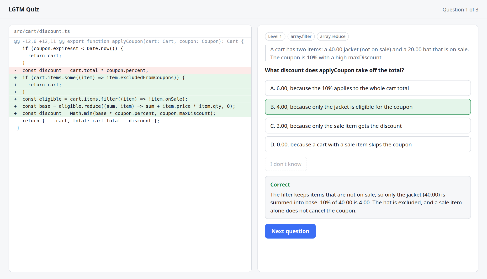
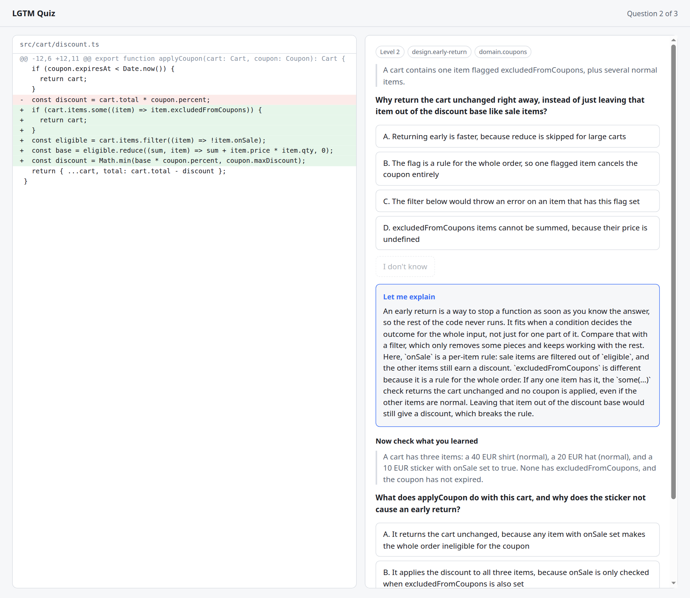

<h1 align="center">lgtm-quiz</h1>

<p align="center">
  <b>Did you actually read that code?</b><br>
  A tiny quiz that runs before you commit and makes sure you understand what your AI just wrote.
</p>

---

AI assistants write code faster than anyone can read it, and "LGTM" gets typed on diffs nobody really looked
at. `lgtm-quiz` is a small nudge against that. It looks at the changes on your branch, asks you questions about
the **risky parts**, and gives you feedback right away.

It is a reminder, not a lie detector. Someone determined to skip understanding can paste the questions into another AI.
The point is to make you stop for two minutes and look at the code, and to teach you when you can't answer.

## See it

The changed code on the left, a question about it on the right, and feedback after every answer:

<p align="center">
  
</p>

Press **I don't know** and you get a short lesson tied to that code, then a new question to check you got it:

<p align="center">
  
</p>

<sub>The code in these screenshots is a made-up example.</sub>

## How it works

```
 your branch ──► risky changes ──► questions about THIS diff ──► quiz in your browser
                                                                    │
                       explanation after every answer  ◄────────────┤
                       "I don't know" → lesson + a new question  ◄──┘
```

- **Questions come from your diff**, not from a generic bank. They use real scenarios from your change
  ("what happens when the login fails twice in a row?").
- **Three levels**, which you can turn on or off:
  1. **Mechanics**: what does this code do here, with this input?
  2. **Decisions**: why was it done this way instead of another?
  3. **Architecture**: what else does this change affect?
- **"I don't know" is allowed.** Press the button and it explains the concept in plain words, tied to your code,
  then asks a fresh question to check you got it.
- **It learns what you know.** Every answer updates a small personal profile. Basics you keep getting right stop
  coming up, and concepts you miss or press "I don't know" on come back until they stick.
- **Guessable questions are filtered out.** A second pass tries to answer each question *without seeing your code*.
  If it can, the question was too easy or too generic, and it's dropped. That means a small change can end up
  with only one or two questions, which is on purpose.
- **Big changes still get good questions.** On a large branch, the riskiest hunks are chosen (logic, auth, state,
  services) while lockfiles, generated files, imports and log lines are skipped.
- **In your language.** English by default; set `--lang` to quiz yourself in Portuguese, Spanish, German and more.
- **Local and private.** The quiz runs on your machine (`127.0.0.1`, one-time token). The answer key stays on
  the server until you answer.

## Install

You need:

- **Node 20 or newer**: check with `node -v`
- **git**
- **[Claude Code](https://claude.com/claude-code)**, installed and logged in. It is the AI that writes the questions.

Then, one command:

```bash
npm install -g --install-links=true github:JoaoBRBR/lgtm-quiz
```

(The `--install-links=true` part matters: without it, npm 10 installs an empty link instead of the tool.)

Check that it worked:

```bash
lgtm-quiz --help
```

That's the whole installation. It works in **every git repository** on your machine, so there's nothing to set up
per project.

**Update:** run the install command again.
**Uninstall:** `npm uninstall -g lgtm-quiz`

> Works on Linux and macOS. On Windows the quiz still starts but may not open the browser by itself; copy the
> `http://127.0.0.1:...` link it prints. (Tested so far on Linux with Node 22.)

## Quick start

Work on a branch as usual, then, before you commit or open a PR, from inside the repo:

```bash
lgtm-quiz
```

It compares your current branch with `main`, writes the questions (about 30 seconds), and opens the quiz in your browser.
Answer, read the feedback, and finish to see your score.

The command exits with code `0` if you pass and `1` if you don't, so you can also use it in scripts.

## Options

| Command | What it does |
| --- | --- |
| `lgtm-quiz` | Quiz on your current branch against `main` |
| `lgtm-quiz --base develop` | Compare against another branch |
| `lgtm-quiz --staged` | Only the changes you have staged |
| `lgtm-quiz --levels 1,2,3` | Which question levels to use (default `1,2`) |
| `lgtm-quiz --questions 8` | Maximum number of questions (default `5`) |
| `lgtm-quiz --lang pt-BR` | Language of the questions and the interface (default `en`) |
| `lgtm-quiz --no-validate` | Skip the check that drops guessable questions (faster and cheaper) |
| `lgtm-quiz --no-adaptive` | Don't use or update your knowledge profile for this run |
| `lgtm-quiz --pass 0.8` | Pass line from 0 to 1 (default `0.7`, i.e. 70%) |
| `lgtm-quiz --help` | Show all options |

**Languages.** English is the default. Use `--lang` with a code (`pt-BR`, `es`, `de`) or a name (`"French"`) and the
questions, answers, explanations and the buttons all switch to that language. Code and identifiers stay as they are.
The interface text is translated the first time you use a language and then saved, so later runs start instantly.

If you run it while you're on the base branch itself, it falls back to your staged changes.
Trivial changes (log removals, formatting, version bumps) are skipped, so a small diff can have only one or two questions.

## It learns what you know

Each question is tagged with the concepts it tests (`array.map`, `promise.async`, `angular.signals`...). Your
answers move a confidence score for each concept:

- Right answers raise it. Wrong answers and "I don't know" lower it. Learning something through the lesson
  counts for a little less than knowing it already.
- Confidence **fades with time** (it halves after about 60 days), so something you knew last year gets asked again.
- Once a concept is solid, the basic "what does this do?" questions about it **stop appearing**. Questions about
  *this specific change* never fully fade, because understanding a construct isn't the same as understanding
  what your AI did with it here.
- A mastered basic still shows up now and then, so a lucky streak can't switch a topic off for good.

```bash
lgtm-quiz profile          # what you know, weakest first
lgtm-quiz profile reset    # start over
lgtm-quiz --no-adaptive    # skip it for one run
```

The profile is a plain JSON file at `~/.config/lgtm-quiz/profile.json`. It stays on your machine and is never sent
anywhere, except that the names of your mastered and shaky concepts are included in the prompt so the AI can pick
better questions.

## Quiz before every commit (optional)

Prefer it automatic? Turn on the commit hook, **in the repos where you want it**:

```bash
lgtm-quiz hook on       # from inside the repo
lgtm-quiz hook off      # remove it again
lgtm-quiz hook status
```

After that, `git commit` opens the quiz on what you staged, and the commit only goes through if you pass.
If you fail, your changes stay staged and nothing is lost: read the code and commit again for fresh questions.

- **Nothing is committed to the repo.** The hook lives inside `.git`. With Husky it creates a local
  `.husky/pre-commit` that is excluded through `.git/info/exclude`, so your teammates never see it.
- **It never overwrites a hook you already have.** If one exists, it tells you the line to add yourself.
- **It never locks you out.** If the quiz itself can't run (no `claude`, no network), the commit goes through
  with a warning.
- **Passing once is enough.** If a commit is retried with exactly the same staged changes, you aren't quizzed twice.
- **Skip it when you must:** `git commit --no-verify`, or `LGTM_SKIP=1 git commit`.
- If you stop answering, the commit is cancelled after 30 minutes.

## Settings per repository

Install once, configure per repo. If you work on a frontend and a backend with different needs, put your
preferences in `~/.config/lgtm-quiz/config.json`. Top-level values apply everywhere, and each entry in `repos`
overrides them for one repository (use its full path):

```json
{
  "passRate": 0.7,
  "language": "en",
  "repos": {
    "/home/me/work/frontend": { "base": "develop", "levels": [1, 2, 3] },
    "/home/me/work/backend":  { "base": "main", "questions": 8 }
  }
}
```

Priority, strongest first: **command-line flags**, then the **`repos` entry**, then the **top-level values**, then the built-in defaults.

Available settings: `base`, `levels`, `questions`, `passRate`, `language`, `validate` and `adaptive`.

Nothing is ever written into your repositories. The last generated questions and translated interface texts are
cached in `~/.cache/lgtm-quiz/`.

## Troubleshooting

| Problem | What to do |
| --- | --- |
| `lgtm-quiz: command not found` right after installing | You probably left out `--install-links=true`. Run `npm uninstall -g lgtm-quiz`, then install again with the full command above. |
| `claude: command not found` | Install Claude Code and log in, then try again. |
| The browser doesn't open | Copy the `http://127.0.0.1:...` link from the terminal into your browser. |
| `Branch "main" not found` | Your base branch has another name. Use `--base <name>` or set it in the config. |
| `No changes to ask about` | The branch has no changes against the base. Make a change, or use `--staged`. |
| A commit seems stuck | The hook is waiting for you to finish the quiz. Look for the browser tab, or press Ctrl+C to cancel. |
| Fewer questions than expected | Trivial changes are skipped and guessable questions are dropped. Use `--no-validate` to keep them. |

## Current limits

This is an early version. Be aware that:

- The AI can write a bad question. Some are too easy, and the right answer is sometimes the longest one. Please open an issue when you see one.
- Only multiple-choice questions exist for now. Written answers and "explain this function in your own words" are planned.
- The profile only knows what you answer here. Concepts you know but haven't been asked about yet start at zero.

## Roadmap

- [x] A second check that filters out guessable questions
- [x] Smarter selection of the riskiest changes on big branches
- [ ] Written and "explain it" questions, and later voice answers
- [x] A personal profile, so concepts you already know get asked less
- [x] Optional `git commit` hook, opt-in per repository
- [ ] Other AI backends besides Claude Code (Codex, Gemini, local models)

## Development

```bash
git clone https://github.com/JoaoBRBR/lgtm-quiz.git
cd lgtm-quiz
npm install      # dev dependencies (TypeScript)
npm link         # makes the lgtm-quiz command point at this folder
npm run build    # rebuild after changing src/
npm test         # run the tests
```

The compiled `dist/` folder is committed on purpose: it lets `npm install -g github:...` work without a build step,
so run `npm run build` and commit `dist/` together with your source changes.

The design notes are in [`SPEC.md`](SPEC.md).

## Contributing

Ideas, bad questions and bug reports are welcome. Open an issue and include, if you can, the kind of change
you ran it on (never paste private code).

## License

[MIT](LICENSE). Use it however you like.
